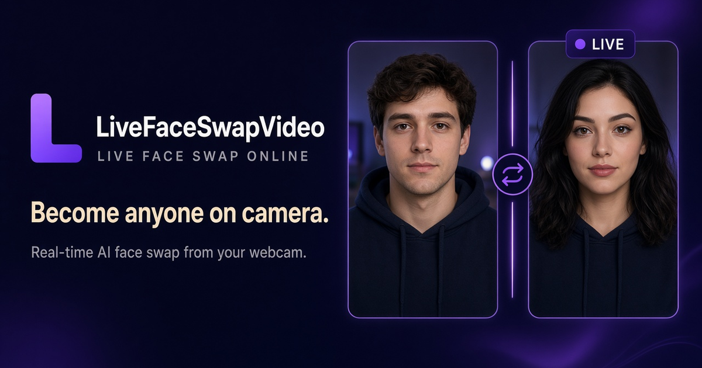
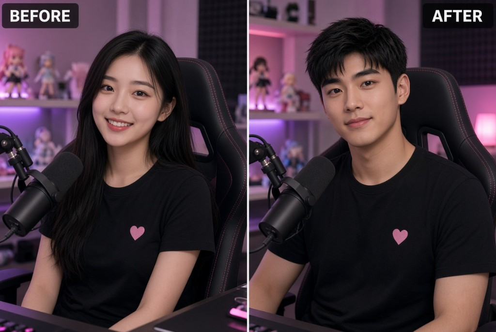
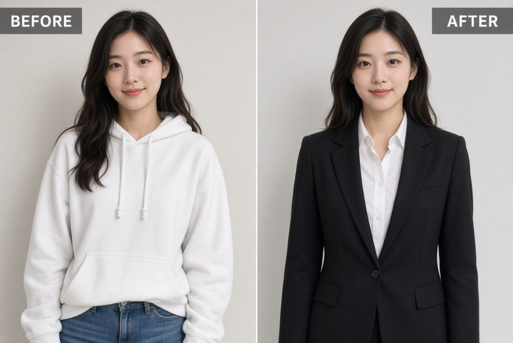
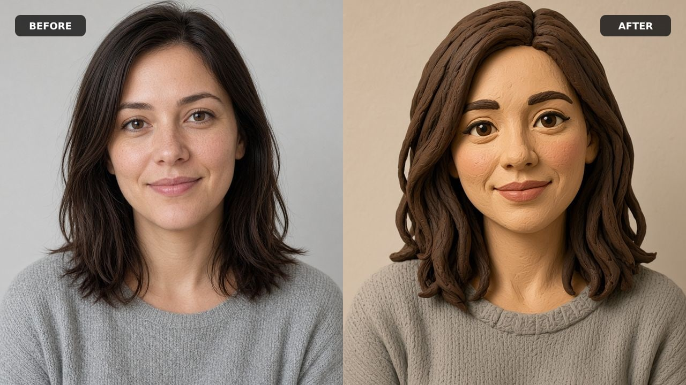
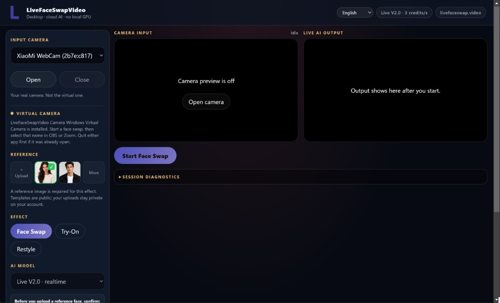

# LiveFaceSwapVideo

[English](README.md) | [简体中文](README.zh-CN.md)

  

Public brand repository for [LiveFaceSwapVideo](https://livefaceswap.video). The website describes a cloud live-camera studio: you choose a reference portrait you have permission to use, turn on a camera, and watch Face Swap, Try-On, or Restyle in the browser. [LiveFaceSwapVideo Desktop](https://livefaceswap.video/desktop) publishes Windows installers and a stable macOS release that send the live result to other apps through a virtual camera named LiveFaceSwapVideo Camera.

This repository is the public introduction to that product and a place for a small local example. The face-swap engine, the website implementation, and the desktop application source are not published here. Using the website does not make those private components open source.

Product pages change. The snapshot below was read from the public site on **2026-11-19**. When this page and the website disagree, follow the website. The macOS desktop release status is the exception: the maintainer confirms that the Apple Silicon build is a stable release.

## Start here

- [Open the live studio](https://livefaceswap.video) for the browser preview.
- [Read the desktop page](https://livefaceswap.video/desktop) before installing Windows or the stable macOS release.
- [Snap Camera alternative](https://livefaceswap.video/snap-camera-alternative) explains the virtual-camera setup after Snap Camera shut down.
- [How to change your face in a live stream](https://livefaceswap.video/blog/how-to-change-face-in-live-stream) walks through OBS, Twitch, TikTok Live, and Zoom.
- [Read current plans](https://livefaceswap.video/pricing) before relying on any price or credit total in this file.
- [Read the acceptable-use policy](https://livefaceswap.video/acceptable-use) before uploading a face or going live.
- Run the [local portrait-consent preflight](examples/portrait-consent-preflight/README.md) on your own machine. It records your answers. It does not contact the service and it does not approve a session.

Support requests go to the [contact page](https://livefaceswap.video/contact) or `support@livefaceswap.video`. The contact page says the team responds within one to two business days. The same address is the abuse-report address published on the acceptable-use policy.

## Public images

Pictures from the [homepage](https://livefaceswap.video) and the [desktop page](https://livefaceswap.video/desktop).

### Homepage examples

### Desktop preview

The desktop page publishes this workspace preview. The picture itself labels the installed virtual camera as the Windows virtual camera, and the selected model shown there is Live V2.0.

## What the public site describes

The homepage and desktop page describe these product boundaries:

- Browser preview without installing the desktop app. The site says cloud processing removes the need for a local GPU or a downloaded model, and that a camera, a stable connection, and a supported browser are required. It does not name the supported browsers on the pages read for this snapshot.
- Three live effects on the homepage: Face Swap, Try-On, and Restyle. Try-On is described as keeping the person's face and posture while changing clothes. Restyle is described as redrawing the live feed, with claymation, pixel art, and cyberpunk given as examples, while identity and motion stay.
- A reference image for effects that require one. The homepage says templates are public and uploaded portraits stay on the account.
- Reference-photo guidance: one clear, front-facing portrait, with eyes, mouth, and the face outline visible in even light. The site says to avoid group photos, heavy blur, strong shadows, and covered faces.
- An encrypted WebRTC connection from the browser to the realtime provider for the live camera stream. The homepage and privacy policy say LiveFaceSwapVideo does not record or store the camera feed or the live AI output. Uploaded reference portraits are saved on the account. The privacy policy says a third-party provider processes the live session, and that reference portraits can be screened for safety.
- Desktop output through **LiveFaceSwapVideo Camera**, for applications that let the user choose a camera. The browser preview itself is described as an on-site preview.
- The published model name on these pages is **Live V2.0**. The site also says the studio can show the selected realtime model. No other model name was published on the pages read for this snapshot.
- Account requirement: the [terms](https://livefaceswap.video/terms) say the person creating an account must be 18 or older. They also say the service is not offered for users located in the European Union.

The desktop page names these applications as places where a selectable camera can be used. It also says other apps that let you choose a video source may work. This list is the site's list, not a separate compatibility certificate:

| Group | Names published on the desktop page |
| --- | --- |
| Streaming software | [OBS Studio](https://livefaceswap.video/face-swap-for-obs), Streamlabs Desktop, PRISM Live Studio, TikTok LIVE Studio, XSplit Broadcaster, vMix |
| Streaming platforms | [Twitch](https://livefaceswap.video/face-swap-for-twitch), [YouTube Live](https://livefaceswap.video/face-swap-for-youtube-live), [TikTok LIVE](https://livefaceswap.video/face-swap-for-tiktok-live), Facebook Live, Instagram Live, Kick |
| Meeting apps | [Zoom](https://livefaceswap.video/face-swap-for-zoom), [Microsoft Teams](https://livefaceswap.video/face-swap-for-microsoft-teams), [Google Meet](https://livefaceswap.video/face-swap-for-google-meet), Webex, Slack |
| [Video calls](https://livefaceswap.video/face-swap-for-video-calls) | [Discord](https://livefaceswap.video/face-swap-for-discord), WhatsApp, Telegram |

The homepage hero names OBS, Zoom, and Discord in particular. The desktop guide describes the practical route: install the desktop app, start a session, then select LiveFaceSwapVideo Camera in the other application, and run a private preview before a public broadcast.

## Browser preview and desktop

| Path | What the site says it is for | Boundary published on 2026-11-19 |
| --- | --- | --- |
| Browser studio | Try a reference, camera, effect, and model on [livefaceswap.video](https://livefaceswap.video) | Preview in the browser. No separate install. |
| Windows desktop | Send live output to other software through LiveFaceSwapVideo Camera | The desktop page labels the current Windows release **0.1.17**, offers separate Windows 11 and Windows 10 installers, and describes them as code-signed. The Windows 11 button resolved to `LiveFaceSwapVideo-Setup-0.1.17.exe`. The Windows 10 button resolved to `LiveFaceSwapVideo-Win10-Setup-0.1.16.exe`. |
| macOS desktop | Same virtual-camera route, as a stable release | Apple Silicon build **0.1.16**: `LiveFaceSwapVideo-0.1.16.dmg`. macOS may require allowing the app in Privacy & Security. |
| Linux | Mentioned only in the desktop FAQ | The FAQ says Linux is still preview-only. No Linux installer was published on that page. |

The desktop page calls the Windows download free and says the app uses the same LiveFaceSwapVideo credits as the website. Installers are reached from the buttons on that page. This repository does not redistribute them, and it does not publish install commands for the private engine.

The signature claim above is the website's description. This repository's snapshot did not independently verify code signatures.

## Credits and plans

The pricing page is the authority for current amounts. On 2026-11-19 it published this metering rule: credits pay for live Face Swap and Try-On on Live V2.0 at **3 credits per second**, and billing starts only after the AI video appears. Camera setup, choosing a photo, connecting, queue, and warmup are described as not charged. The visible pricing copy does not state a separate Restyle rate.

Visible homepage and pricing-FAQ text says a new account receives **100 credits**, described as about 33 seconds on Live V2.0. An embedded free-plan string in the pricing page data says "Sign up and get 50 credits" and was not visible in the rendered homepage or pricing FAQ. Until the site uses one figure, treat the live page you see while signed out as the offer.

Annual subscription cards visible on the pricing page:

| Plan | Price shown | Credits shown | Live V2.0 time shown on the page |
| --- | --- | --- | --- |
| Starter — Annual | $11.92 per month, billed $143 yearly | 43,200, granted once | About 4 hours |
| Pro — Annual | $23.90 per month, billed $286.80 yearly | 168,000, granted once | About 15.6 hours |
| Ultra — Annual | $79.92 per month, billed $959 yearly | 720,000, granted once | About 66.7 hours |

The pricing FAQ states **Starter monthly** as **$14.90 / 3,600 credits**, about 20 minutes on Live V2.0. Monthly feature strings, without a monthly dollar price in the fetched page, list Pro at 14,000 credits per month (about 78 minutes) and Ultra at 60,000 credits per month (about 5.6 hours). Those strings say unused monthly credits roll over for 1 month. The FAQ says each monthly grant is valid for 60 days, a yearly allowance is granted once and stays valid for 1 year, and credits that expire sooner are used first.

The FAQ also names one-time packs **Premium ($49.90)** and **Ultra ($499.90)**. Packs do not renew. Pack feature strings give about 1.8 hours for the Premium pack and about 27.8 hours for the Ultra pack on Live V2.0, with pack credits valid for 1 year. The same strings mention Starter and Standard pack durations of about 30 minutes without a dollar price in the FAQ. Subscription and pack copy on the page says Face Swap and Try-On have no watermark.

The FAQ says refunds depend on usage and are reviewed case by case, and that renewal can be canceled under Settings → Billing. Those rules also appear, in more detail, in the [terms](https://livefaceswap.video/terms).

## Portrait permission and responsible use

LiveFaceSwapVideo's public rules are the ones that govern the service. This is a short reading guide, not a replacement for the [acceptable-use policy](https://livefaceswap.video/acceptable-use), [terms](https://livefaceswap.video/terms), or [privacy policy](https://livefaceswap.video/privacy).

- Use your own face, or a face for which every identifiable person has given clear, informed, voluntary, and demonstrable consent for AI processing and derivative output. The policy says a public photo, a social-media image, a news photo, a street photo, a screenshot, or an old private photo is not that consent.
- Do not use the service with a minor, or with a face that appears to be a minor. The published age rule for an account holder is 18 or older.
- Do not use a living celebrity, politician, influencer, athlete, actor, singer, streamer, or other recognizable public person unless you are that person and can show sufficient authorization. The terms also restrict deceased public figures where their rights remain protected.
- The acceptable-use policy limits the service to lawful creative and entertainment use. It prohibits impersonation, fraud, identity-check evasion, harassment, hate, sexual or non-consensual intimate imagery, and political deception, among other listed harms.
- You remain responsible for uploads, live input, and output. When sharing a result that could be mistaken for a real recording, disclose that it is AI-generated, and leave any disclosure the service applies.
- Preview privately before a stream or a call. A passing local checklist is a note to yourself. It is not permission from the person in the portrait and it is not approval by LiveFaceSwapVideo.

Report abuse to `support@livefaceswap.video` with links or screenshots, account details, and a short description, as the acceptable-use page requests.

## What this repository is for

Published here:

- This English overview and the [Simplified Chinese version](README.zh-CN.md).
- Copies of the public Open Graph image, homepage example images, and desktop preview, kept under [assets/](assets/og-image.png).
- A local, network-free [portrait-consent preflight](examples/portrait-consent-preflight/README.md) that you can run and test with Python's standard library.

Not published here:

- The face-swap engine, model weights, website source, desktop source, account system, or billing system.
- A public API or SDK. Pages that mention API abuse do not document a developer interface, and this repository does not invent one.
- Installer binaries. Use the desktop page.
- A license grant. This repository has no `LICENSE` file. The text and example are here to read and to run locally. They do not license the LiveFaceSwapVideo service, and they do not by themselves grant reuse rights to these files.

Public product questions that can be asked without account data, payment data, portraits, or session recordings can use [GitHub Issues](https://github.com/LiveFaceSwapVideo1/livefaceswapvideo/issues). Account-specific help stays on the contact channel above.

## Language

The English README is the authoritative version of this repository's documentation. [简体中文](README.zh-CN.md) is a translation for Chinese readers. The website itself publishes English, Spanish, Brazilian Portuguese, Japanese, Traditional Chinese, Korean, and Arabic. It did not publish a Simplified Chinese locale in its sitemap on the snapshot date. If the translation and the English text differ, follow the English text, and follow the website for product facts.
