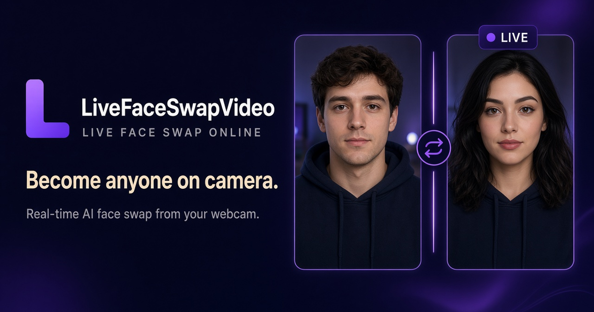
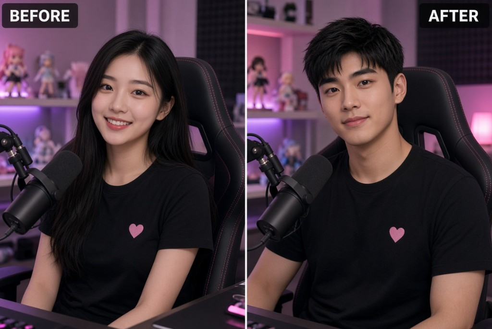
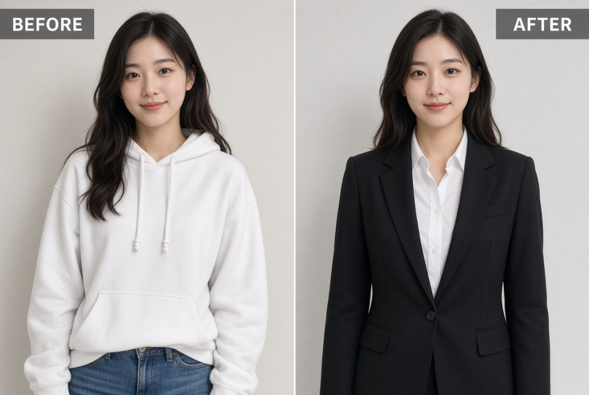
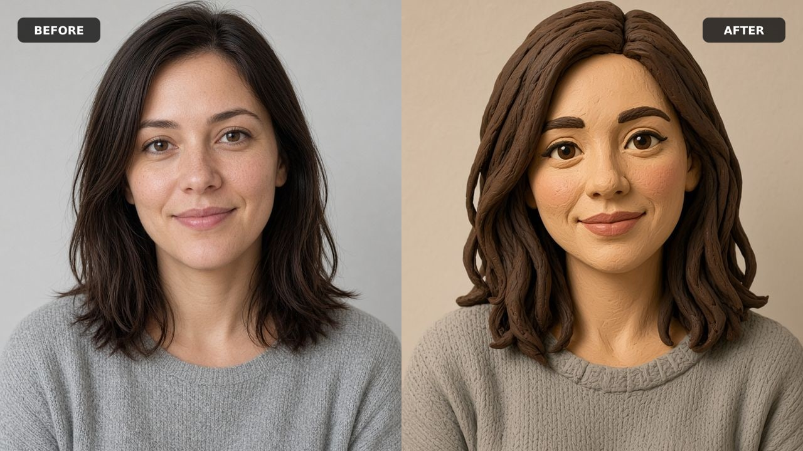
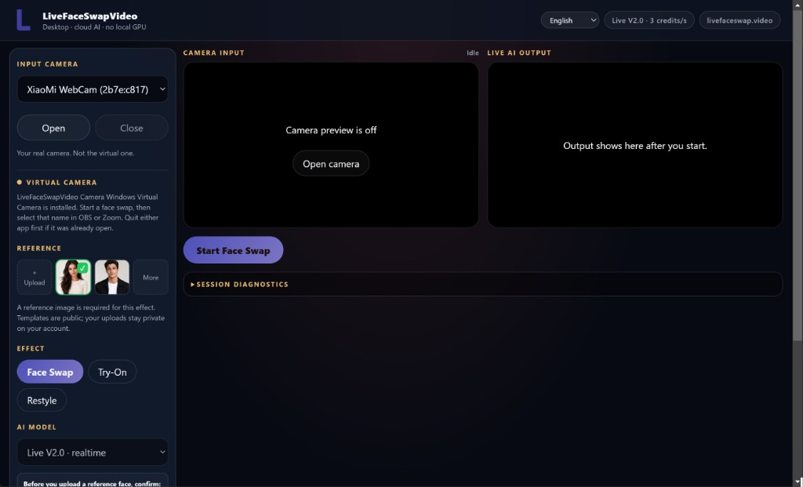

# LiveFaceSwapVideo

[English](README.md) | [简体中文](README.zh-CN.md)

<p align="center">
  <a href="https://livefaceswap.video"></a>
</p>

这是 [LiveFaceSwapVideo](https://livefaceswap.video) 的公开品牌仓库。官网描述的是一个云端实时镜头工作室：选择一张你有权使用的参考人像，打开摄像头，在浏览器里查看 Face Swap、Try-On 或 Restyle。[LiveFaceSwapVideo Desktop](https://livefaceswap.video/desktop) 公开了 Windows 安装包和 macOS 正式版，并通过名为 LiveFaceSwapVideo Camera 的虚拟摄像头，把实时结果送到其他应用。

本仓库用来介绍上述已公开的产品，并放一个可以在本地运行的小示例。换脸引擎、网站实现和桌面应用源代码不在这里。网站可以正常使用，并不表示这些未公开的部分是开源软件。

产品页面会变化。下面的记录读自 **2026-11-19** 的公开网页。若本页与官网不一致，以官网为准。macOS 桌面版的发布状态是例外：维护者确认 Apple Silicon 版本是正式版。

## 从这里开始

- 在 [livefaceswap.video](https://livefaceswap.video) 打开浏览器预览。
- 安装 Windows 或 macOS 正式版之前，先看 [桌面版页面](https://livefaceswap.video/desktop)。
- 引用任何价格或积分数量之前，先看 [当前方案](https://livefaceswap.video/pricing)。
- 上传人脸或公开直播之前，先看 [可接受使用政策](https://livefaceswap.video/acceptable-use)。
- 在自己的电脑上运行 [本地人像同意预检](examples/portrait-consent-preflight/README.md)。它只记录你的回答，不连接服务，也不批准任何会话。

支持请求使用 [联系页面](https://livefaceswap.video/contact) 或 `support@livefaceswap.video`。联系页写明会在一到两个工作日内回复。可接受使用政策也把这个地址列为滥用举报邮箱。

## 公开图片

画面来自[官网首页](https://livefaceswap.video)和[桌面版页面](https://livefaceswap.video/desktop)。

[](https://livefaceswap.video)

### 首页示例

[](https://livefaceswap.video)

[](https://livefaceswap.video)

[](https://livefaceswap.video)

### 桌面版预览

[](https://livefaceswap.video/desktop)

桌面版页面公布了这张工作区预览。图中的虚拟摄像头说明写的是 Windows 虚拟摄像头，所选模型显示为 Live V2.0。

## 官网公开描述的产品

首页和桌面版页面写出了这些边界：

- 浏览器预览不需要安装桌面应用。网站说明云端处理不要求本地 GPU，也不要求下载模型；需要摄像头、稳定连接和受支持的浏览器。本次阅读的页面没有列出具体浏览器名称。
- 首页展示三种实时效果：Face Swap、Try-On 和 Restyle。Try-On 被描述为保持本人的脸和姿态、更换服装。Restyle 被描述为重绘实时画面，举例包括黏土动画、像素画和赛博朋克，身份与动作保持不变。
- 需要参考图的效果要提供一张参考图。首页写明模板是公开的，上传的人像保存在账户中。
- 参考照片建议：一张清晰、正面的人像，眼睛、嘴和脸部轮廓在均匀光线下可见。网站建议避免合影、严重模糊、强烈阴影和遮挡面部。
- 浏览器通过加密的 WebRTC 连接，把实时镜头流交给实时处理方。首页和隐私政策写明，LiveFaceSwapVideo 不录制、不保存摄像头画面和实时 AI 输出。上传的参考人像会保存在账户中。隐私政策写明由第三方提供方处理实时会话，并且参考人像可能接受安全检查。
- 桌面版通过 **LiveFaceSwapVideo Camera** 向可以选择摄像头的应用输出。浏览器预览被描述为站内预览。
- 这些页面公开写出的模型名称是 **Live V2.0**。网站还表示工作室会显示所选的实时模型。本次阅读没有看到其他模型名称。
- 账户条件：[服务条款](https://livefaceswap.video/terms) 要求创建账户的人年满 18 岁，并写明服务不向位于欧盟的用户提供。

桌面版页面把下列应用列为可以选择摄像头的使用场景，并说明其他允许选择视频源的应用也可能可用。这是官网名单，不是另行出具的兼容认证：

| 类别 | 桌面版页面列出的名称 |
| --- | --- |
| 直播软件 | [OBS Studio](https://livefaceswap.video/face-swap-for-obs)、Streamlabs Desktop、PRISM Live Studio、TikTok LIVE Studio、XSplit Broadcaster、vMix |
| 直播平台 | [Twitch](https://livefaceswap.video/face-swap-for-twitch)、[YouTube Live](https://livefaceswap.video/face-swap-for-youtube-live)、[TikTok LIVE](https://livefaceswap.video/face-swap-for-tiktok-live)、Facebook Live、Instagram Live、Kick |
| 会议应用 | [Zoom](https://livefaceswap.video/face-swap-for-zoom)、[Microsoft Teams](https://livefaceswap.video/face-swap-for-microsoft-teams)、[Google Meet](https://livefaceswap.video/face-swap-for-google-meet)、Webex、Slack |
| [视频通话](https://livefaceswap.video/face-swap-for-video-calls) | [Discord](https://livefaceswap.video/face-swap-for-discord)、WhatsApp、Telegram |

首页首屏特别提到 OBS、Zoom 和 Discord。桌面版指南描述的实际路径是：安装桌面应用，开始会话，然后在另一个应用里选择 LiveFaceSwapVideo Camera，并在公开播出前做一次私人预览。

## 浏览器预览与桌面版

| 路径 | 网站对用途的描述 | 2026-11-19 公开的边界 |
| --- | --- | --- |
| 浏览器工作室 | 在 [livefaceswap.video](https://livefaceswap.video) 试用参考图、摄像头、效果和模型 | 浏览器内预览，不另行安装。 |
| Windows 桌面版 | 通过 LiveFaceSwapVideo Camera 把实时输出送到其他软件 | 桌面版页面把当前 Windows 版本标为 **0.1.17**，分别提供 Windows 11 和 Windows 10 安装包，并描述为已代码签名。Windows 11 按钮解析到 `LiveFaceSwapVideo-Setup-0.1.17.exe`。Windows 10 按钮解析到 `LiveFaceSwapVideo-Win10-Setup-0.1.16.exe`。 |
| macOS 桌面版 | 同样的虚拟摄像头路径，属于正式版 | Apple Silicon 版本仍是 **0.1.16**：`LiveFaceSwapVideo-0.1.16.dmg`。macOS 可能会要求在“隐私与安全性”中允许该应用。 |
| Linux | 只在桌面版常见问题中被提到 | 常见问题写明 Linux 仍只有预览。该页没有发布 Linux 安装包。 |

桌面版页面称 Windows 下载免费，并说明应用使用与网站相同的 LiveFaceSwapVideo 积分。安装包从该页按钮获取。本仓库不转分发安装包，也不提供私有引擎的安装命令。

上面的“代码签名”是网站自己的描述。本次记录没有单独核验签名。

## 积分与方案

定价页是当前数量的依据。2026-11-19 公布的计费规则是：积分用于 Live V2.0 上的实时 Face Swap 和 Try-On，价格为 **每秒 3 积分**，并且只在 AI 视频出现后开始计费。网站把打开摄像头、选择照片、连接、排队和预热描述为不计费。可见的定价文案没有单独写出 Restyle 的费率。

首页和定价页常见问题的可见文字写明，新账户获得 **100 积分**，并描述为在 Live V2.0 上大约 33 秒。定价页数据里另有一条未显示在首页和定价常见问题中的免费方案字符串，写着注册获得 50 积分。在官网统一这个数字之前，以你未登录时实际看到的页面为准。

定价页当时可见的年度订阅卡片：

| 方案 | 显示的价格 | 显示的积分 | 页面给出的 Live V2.0 时长 |
| --- | --- | --- | --- |
| Starter — Annual | 每月 $11.92，按年收取 $143 | 43,200，一次性发放 | 约 4 小时 |
| Pro — Annual | 每月 $23.90，按年收取 $286.80 | 168,000，一次性发放 | 约 15.6 小时 |
| Ultra — Annual | 每月 $79.92，按年收取 $959 | 720,000，一次性发放 | 约 66.7 小时 |

定价常见问题把 **Starter 月付** 写为 **$14.90 / 3,600 积分**，在 Live V2.0 上大约 20 分钟。月付功能字符串没有在抓取到的页面中带上 Pro 和 Ultra 的月费金额，其中 Pro 为每月 14,000 积分（约 78 分钟），Ultra 为每月 60,000 积分（约 5.6 小时）。这些字符串写明未使用的月度积分可结转 1 个月。常见问题写明每笔月度发放有效期 60 天，年度额度在开始时一次性发放并有效 1 年，更早到期的积分先被使用。

常见问题还列出一次性积分包 **Premium（$49.90）** 和 **Ultra（$499.90）**。积分包不会自动续费。积分包功能字符串给出 Premium 约 1.8 小时、Ultra 约 27.8 小时的 Live V2.0 时长，积分自购买起有效 1 年。同一组字符串还提到 Starter 和 Standard 积分包约 30 分钟，但常见问题没有给出对应美元价格。订阅和积分包文案写明 Face Swap 与 Try-On 无水印。

常见问题写明退款取决于使用情况并逐案审核，续费可以在 Settings → Billing 取消。更完整的规则在 [服务条款](https://livefaceswap.video/terms)。

## 人像授权与负责任使用

约束这项服务的是 LiveFaceSwapVideo 已经公开的规则。本节只是阅读指南，不能代替 [可接受使用政策](https://livefaceswap.video/acceptable-use)、[服务条款](https://livefaceswap.video/terms) 和 [隐私政策](https://livefaceswap.video/privacy)。

- 使用你自己的脸，或者每一位可识别的人都已就 AI 处理和衍生内容作出清楚、知情、自愿且能够证明的同意。政策写明，公开照片、社交媒体图片、新闻图片、街拍、截图或一张旧的私人照片，都不构成这种同意。
- 不要把服务用于未成年人，也不要使用看起来属于未成年人的面孔。公开的账户年龄要求是年满 18 岁。
- 不要使用在世名人、政治人物、网红、运动员、演员、歌手、主播或其他可识别公众人物，除非你本人就是该人并且能够出示充分授权。条款对权利仍受保护的已故公众人物也作了限制。
- 可接受使用政策把服务限于合法的创作和娱乐用途，并禁止冒充、欺诈、规避身份核验、骚扰、仇恨、性内容或未经同意的私密影像，以及政治欺骗等列出的危害。
- 上传内容、实时输入和输出由你负责。分享可能被误认为真实录制的结果时，标明它由 AI 生成，并保留服务附上的披露。
- 在直播或通话前先私下预览。本地清单通过，只是你自己的记录。它不是肖像本人的许可，也不是 LiveFaceSwapVideo 的批准。

按可接受使用页面的要求，向 `support@livefaceswap.video` 举报滥用，并附上链接或截图、账户信息和简短说明。

## 本仓库的范围

这里公开的内容：

- 这份英文说明的简体中文译文，以及 [英文原文](README.md)。
- 从公开网站复制的 Open Graph 图、首页示例图和桌面版预览，放在 [assets/](assets/og-image.png)。
- 一个不访问网络的 [人像同意预检](examples/portrait-consent-preflight/README.md)，可用 Python 标准库运行和测试。

<a id="local-preflight"></a>

仓库根目录下可以用下面的命令查看附带的未通过样例，并运行测试。样例里的每个答案都是 `false`。只有在对应陈述对你的人像和这次使用确实成立时，才把复制后的文件改为 `true`。程序退出码 0 只表示本地记录完整，不表示获得肖像许可或服务批准。

```bash
python3 examples/portrait-consent-preflight/preflight.py \
  examples/portrait-consent-preflight/unchecked-answers.json

python3 -m unittest discover -s examples/portrait-consent-preflight -p 'test_*.py'
```

这里没有公开的内容：

- 换脸引擎、模型权重、网站源代码、桌面应用源代码、账户系统或计费系统。
- 公开 API 或 SDK。页面中出现的 API 滥用禁止，并没有因此提供开发者接口；本仓库也不编造接口。
- 安装包。请使用桌面版页面。
- 许可证授予。本仓库没有 `LICENSE` 文件。这些文字和示例供阅读及本地运行。它们不许可 LiveFaceSwapVideo 服务本身，也不因放在仓库里就自动授予这些文件的再利用权利。

不包含账户数据、支付数据、人像或会话录像的公开产品问题，可以使用 [GitHub Issues](https://github.com/LiveFaceSwapVideo1/livefaceswapvideo/issues)。与具体账户有关的帮助仍走上面的联系渠道。

## 语言

英文 README 是本仓库文档的权威版本。[简体中文](README.zh-CN.md) 是给中文读者的译文。官网站点地图在本次记录日公布了英语、西班牙语、巴西葡萄牙语、日语、繁体中文、韩语和阿拉伯语，没有简体中文站点。若译文与英文不一致，以英文为准；产品事实以官网为准。
